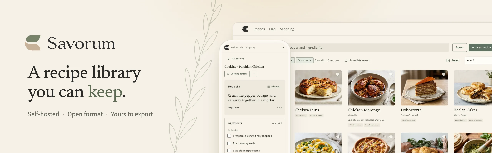

# Savorum

<picture>
  <source media="(prefers-color-scheme: dark)" srcset="docs/images/banner-dark.webp">
  <source media="(prefers-color-scheme: light)" srcset="docs/images/banner-light.webp">
  
</picture>

Savorum is a recipe library you can keep. Save recipes from websites and other
apps, organize them into books, scale a recipe for the batch you need, plan the
week's meals, and print a copy for the kitchen. Your recipes stay yours: export
them any time in [SREF](https://savorum.app/sref/), an open recipe format.

This repository is Savorum Core, the free, open-source application. It is a
single Go program with a built-in web interface and a SQLite database, so there
is nothing else to install or run.

If you would rather not run it yourself, [Savorum Cloud](https://savorum.app/pricing/)
is the same library, hosted for you.

## Documentation

- **Run it and use it:** [docs.savorum.app](https://docs.savorum.app/) covers
  [getting started](https://docs.savorum.app/start/getting-started/), everyday
  cooking and planning, and running a server for your household.
- **Build on it:** [api.savorum.app](https://api.savorum.app/) has the HTTP API
  reference and integration guides.
- **Change it:** read [CONTRIBUTING.md](CONTRIBUTING.md). The
  [docs folder](docs/README.md) holds contributor material.

Report a vulnerability privately, as [SECURITY.md](SECURITY.md) describes.

## Compatibility

Savorum has no stable release yet. If you want to keep your library, run a
tagged release: tagged releases upgrade your database safely. A build from
between releases may change the database in ways that cannot be upgraded.

## License

Savorum is available under the [GNU Affero General Public License v3.0](LICENSE).
